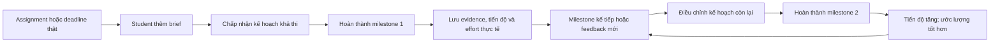

# StudyFlow AI — Metrics Pack

**Học viên:** Phan Thị Khánh Linh  
**MHV/MSSV:** 2A202602360  
**Dự án:** StudyFlow AI — AI Personal Assistant for Students  
**Phạm vi:** một use case chính; không đại diện cho toàn bộ sản phẩm  
**Giai đoạn:** prototype / pre-PMF; baseline và target sẽ được điền sau khi có tracking ổn định

## Tóm tắt chuỗi quyết định

| Quyết định | Kết luận |
|---|---|
| Core job | Chia một assignment thành các bước khả thi để tiến đều và nộp đúng hạn. |
| Core action | Sinh viên hoàn thành một milestone đã lên kế hoạch và xác nhận kết quả. |
| Natural cadence | Theo tiến trình và deadline; đo chính theo tuần ở cấp sinh viên. |
| Activation | Hoàn thành milestone đủ điều kiện đầu tiên trong 72 giờ sau khi thêm assignment. |
| North Star | Số milestone học tập hoàn thành đúng hạn, có bằng chứng, trong mỗi tuần. |
| Retention | Sinh viên đủ điều kiện quay lại hoàn thành ít nhất một milestone đủ điều kiện trong tuần W1/W4/W8. |
| Loop | Assignment → kế hoạch → milestone hoàn thành → trạng thái/ước lượng tốt hơn → milestone tiếp theo. |

---

# 00 — Dự án, persona, core job

## 00.1 Dự án và phạm vi

**StudyFlow AI** là trợ lý học tập giúp sinh viên chuyển brief của một assignment thành kế hoạch gồm các milestone nhỏ, sắp xếp chúng quanh lịch học và cập nhật kế hoạch khi tiến độ thay đổi.

Bài này chỉ phân tích use case:

> **Lập và thực thi kế hoạch cho một assignment có deadline.**

Các use case khác như hỏi đáp kiến thức, tóm tắt tài liệu, luyện thi và quản lý câu lạc bộ nằm ngoài phạm vi.

## 00.2 Persona chính

Sinh viên đại học đang học từ ba môn trở lên, thường có nhiều assignment chồng deadline và đã từng trì hoãn vì không biết bắt đầu từ đâu.

## 00.3 Core job bằng lời người dùng

> “Tôi cần biến yêu cầu của một assignment thành các bước vừa sức và biết việc nào phải làm tiếp theo, vì tôi muốn tiến đều và nộp bài đúng hạn mà không phải dồn việc vào phút cuối.”

## 00.4 Ranh giới và giả định

- Sinh viên chủ động thêm assignment và xác nhận kế hoạch; AI không tự tạo value chỉ bằng việc sinh output.
- Một assignment có deadline cách thời điểm thêm ít nhất bốn ngày mới vào phép đo activation chuẩn.
- Một milestone hợp lệ có kết quả quan sát được, thời lượng ước tính từ 15 đến 120 phút và thuộc đúng assignment.
- Baseline và target chưa có dữ liệu nên được ghi `[ĐO BASELINE]` và `[ĐẶT TARGET SAU BASELINE]`, không tự bịa số.

**Gate 0:** phạm vi chỉ có một persona, một core job và một use case đủ hẹp để bảo vệ.

---

# 01 — Core Action Card

## 01.1 Phân biệt bốn khái niệm

| Khái niệm | Câu trả lời |
|---|---|
| Core job | Chia assignment thành tiến trình khả thi để hoàn thành đúng hạn. |
| Core action | Sinh viên hoàn thành một milestone đã được lên kế hoạch và xác nhận kết quả. |
| Core value | Sinh viên tạo tiến bộ thật, giảm phần việc còn lại và biết bước tiếp theo. |
| Core value event | `study_task_completed` đáp ứng đủ quality rule. |

Core action không phải “hỏi AI” hay “tạo kế hoạch”: kế hoạch chỉ là phương tiện. Value chỉ được chứng minh khi sinh viên hoàn thành một phần việc có ý nghĩa.

## 01.2 Core Action Card

| Thành phần | Định nghĩa |
|---|---|
| Target user | Sinh viên có assignment đang hoạt động và đã chấp nhận kế hoạch. |
| Core job | Tiến đều qua các phần việc để nộp assignment đúng hạn. |
| Core action | Hoàn thành một milestone đã lên kế hoạch và xác nhận kết quả. |
| Object | `study_task` thuộc một `assignment`. |
| Preconditions | Assignment có deadline; task đã được user chấp nhận; task có outcome, `planned_due_at` và thời lượng ước tính 15–120 phút. |
| Completion rule | Task chuyển từ `in_progress` hoặc `planned` sang `completed` bởi user; có `completed_at` và một dạng bằng chứng hợp lệ. |
| Core value | Tiến độ thật được tạo ra; khối lượng còn lại và bước tiếp theo trở nên rõ ràng. |
| Evidence of value | Link/tệp kết quả, checklist outcome hoàn tất hoặc xác nhận kèm ghi chú; trạng thái vẫn là `completed` sau 24 giờ. |
| Candidate event | `study_task_completed` |

### Quality rule của core value event

Một `study_task_completed` đủ điều kiện khi đồng thời thỏa mãn:

1. Task thuộc assignment chưa bị hủy và đã được user chấp nhận trước khi hoàn tất.
2. Task có outcome cụ thể và `estimated_minutes` từ 15 đến 120 phút.
3. Có `evidence_type` và `evidence_ref` hoặc checklist outcome đã hoàn tất.
4. `completed_at <= planned_due_at` để được tính là đúng hạn.
5. Task không bị mở lại trong 24 giờ vì “chưa thực sự hoàn tất”.

## 01.3 Tự kiểm 5 tiêu chí

| Tiêu chí | Kết quả | Lý do |
|---|---|---|
| Gần core value | Đạt | Completion chứng minh có tiến độ, không chỉ có ý định. |
| Có thể lặp lại khi nhu cầu quay lại | Đạt | Mỗi assignment có nhiều milestone; assignment mới tạo vòng lặp mới. |
| Quan sát chính xác lúc hoàn tất | Đạt | Có state transition, timestamp và bằng chứng. |
| Tăng action có ý nghĩa | Đạt có điều kiện | Chỉ tốt khi task đủ lớn, đúng hạn và không bị mở lại. |
| Team có thể tác động | Đạt | Team cải thiện chia task, ước lượng, lịch và cơ chế recovery. |

**Kết quả:** đạt 5/5; điều kiện chất lượng ngăn team tối ưu bằng cách chia task quá nhỏ.

### Các ứng viên bị loại

- `app_opened`: chỉ đo truy cập, không chứng minh tiến độ học tập.
- `prompt_sent`: đo tương tác với AI, không đo value được nhận.
- `study_plan_generated`: là output của hệ thống, có thể tăng dù user không làm gì.
- `task_checked`: tên mơ hồ, có thể chỉ là thao tác UI; không có completion rule.

**Gate 1:** có actor, object, completion rule; core action đạt ít nhất 4/5 tiêu chí và không phải output tự sinh.

---

# 02 — Action Nature Card + cadence

## 02.1 Action Nature Card

| Thành phần | Phân tích |
|---|---|
| Actor | `student_id`; object là `study_task_id` thuộc `assignment_id`. |
| Intent | Tạo tiến độ thật để tránh dồn việc và nộp đúng hạn. |
| Trigger | Brief mới, deadline đến gần, milestone trước hoàn tất hoặc phản hồi từ giảng viên/nhóm. |
| Effort | 3–8 phút để kiểm tra/chấp nhận kế hoạch; 15–120 phút để hoàn thành một milestone; cần brief, lịch rảnh và tài liệu môn học. |
| Value timing | Rõ bước tiếp theo ngay sau planning; value chính xuất hiện khi milestone hoàn tất; value tích lũy đến lúc nộp bài. |
| State | Brief, deadline, task list, thứ tự phụ thuộc, lịch, ước lượng, completion và evidence được lưu. |
| Dependency | Lịch học, môn khác, độ khó task, tài liệu, teammate và phản hồi giảng viên. |
| Repeat condition | Còn milestone chưa xong, có feedback mới hoặc có assignment mới. |

## 02.2 Nature trước, nurture sau

### Nature

- Hành vi chính là **tiến trình tích lũy trong một project có deadline**.
- Nhu cầu không nhất thiết xuất hiện mỗi ngày; nó tăng khi assignment được giao, khi đến lịch làm task và khi deadline gần.
- Một tuần có nhiều task không mặc định tốt hơn nếu task bị chia vụn hoặc không đóng góp cho assignment.

### Nurture

- Nhắc trước `planned_start_at` khi user đã chủ động đưa task vào lịch.
- Gợi ý recovery sau một task bị miss, cho phép reschedule phần còn lại.
- Tóm tắt tiến độ tuần để user điều chỉnh kế hoạch.
- Không dùng streak hằng ngày, notification ngẫu nhiên hoặc “mở app để giữ chuỗi”.

Nếu bỏ notification, user vẫn có lý do quay lại: assignment còn dang dở, milestone kế tiếp và deadline thật vẫn tồn tại.

## 02.3 Kết luận cadence

> Đối với sinh viên có assignment đang hoạt động, core action hoàn thành một milestone thường xuất hiện từ một đến vài lần mỗi tuần, tùy workload và deadline, vì tiến độ được tạo theo các phần việc của assignment chứ không theo nhu cầu mở app hằng ngày. Do đó, nhịp đo phù hợp là **tuần học** ở cấp **student**, với chẩn đoán bổ sung ở cấp `assignment` và `study_task`.

**Week boundary:** Thứ Hai 00:00 đến Chủ Nhật 23:59 theo timezone của trường/user. Event lưu UTC và quy đổi theo `timezone_at_event`.

**Gate 2:** cadence tuần xuất phát từ workflow thật; daily chỉ dùng để debug timing, không phải retention chính.

---

# 03 — Metric System

## 03.1 Activation — first value, không phải active

| Thành phần | Định nghĩa |
|---|---|
| Start event | `assignment_added` cho assignment có deadline cách thời điểm thêm ít nhất bốn ngày. |
| Activation event | `study_task_completed` đủ quality rule đầu tiên của assignment đó. |
| Time window | Trong 72 giờ kể từ `assignment_added` và trước `assignment_due_at`. |
| Unit | `student_id` mới chưa từng activate. |
| Segment | Sinh viên có assignment đủ điều kiện, không phải sample/demo assignment. |

```text
72h activation rate
= số student đủ điều kiện có first qualified study_task_completed trong 72h
  / số student mới có qualified assignment_added
```

**Active ≠ Activated:** student mở app, chỉnh profile, thêm assignment hoặc chấp nhận plan có thể là active, nhưng chưa activated. Activation chỉ xảy ra khi milestone đầu tiên hoàn tất và value đầu tiên được chứng minh.

## 03.2 Engagement — frequency và depth

### Metric 1 — Qualified milestones per engaged student per study week

```text
Tổng số unique study_task_id có qualified study_task_completed trong tuần
/ số student có ít nhất một assignment đủ điều kiện trong tuần
```

Đây là frequency metric. Luôn phân phối theo median/P25/P75 thay vì chỉ dùng average để tránh vài power user che khuất phần còn lại.

### Metric 2 — On-time planned milestone rate

```text
Số planned tasks đến hạn trong tuần được hoàn thành trước hoặc đúng planned_due_at
/ tổng số planned tasks đến hạn trong tuần
```

Đây là depth/quality metric. Task bị xóa sau khi đến hạn vẫn nằm trong denominator; task được reschedule chỉ đổi due date khi reschedule xảy ra trước `planned_start_at`.

## 03.3 North Star Metric

### Weekly On-time Verified Study Milestones — WOVSM

> **Số milestone học tập duy nhất được sinh viên hoàn thành đúng hạn, có bằng chứng hợp lệ và không bị mở lại trong 24 giờ, trong mỗi tuần học.**

Metric có đủ ba thành phần:

- **Unit of value:** milestone học tập đã hoàn thành.
- **Quality threshold:** đúng hạn, có evidence, task 15–120 phút, không bị mở lại trong 24 giờ.
- **Frequency:** mỗi tuần học.

```text
WOVSM tuần t
= COUNT(DISTINCT study_task_id)
  WHERE event = study_task_completed
    AND completed_at <= planned_due_at_snapshot
    AND evidence_valid = true
    AND estimated_minutes BETWEEN 15 AND 120
    AND no study_task_reopened within 24h
    AND local_week(completed_at) = t
```

Song song với tổng WOVSM, dashboard phải hiển thị `WOVSM / eligible_student` để tăng trưởng user không che chất lượng value trên mỗi người.

### Vì sao không chọn metric khác làm North Star?

- Số plan AI tạo ra có thể tăng mà không có task nào được làm.
- Time in app có thể tăng khi UX gây khó hiểu.
- DAU ép một workflow theo deadline thành thói quen giả.
- Số task completed thuần dễ bị game bằng cách chia vụn task hoặc tick hoàn tất sai.

## 03.4 Causal metric tree và leading indicators

```text
WOVSM — milestone đúng hạn, có bằng chứng mỗi tuần
├── First-value rate
│   └── 72h activation rate
├── Plan executability
│   └── Feasible plan acceptance rate
└── Recovery before abandonment
    └── 48h missed-task recovery rate
```

| Leading indicator | Định nghĩa | Vì sao dự báo core action lặp lại? | Guardrail đi kèm |
|---|---|---|---|
| 72h activation rate | Công thức tại 03.1. | User đã vượt khoảng cách từ plan sang value thật lần đầu. | W1 retention không được giảm. |
| Feasible plan acceptance rate | Tỷ lệ assignment có plan được user chấp nhận, trong đó mỗi task 15–120 phút, không xung đột lịch và tổng effort không vượt thời gian rảnh khai báo. | Kế hoạch vừa sức làm tăng xác suất task được thực thi. | Tỷ lệ user sửa >50% task ngay trong 24 giờ không được tăng. |
| 48h missed-task recovery rate | Tỷ lệ task bị miss mà user reschedule hợp lệ và hoàn thành task đó hoặc task kế tiếp trong 48 giờ. | Recovery giữ vòng lặp tiếp tục sau sai lệch thực tế. | Số lần reschedule trung vị mỗi task không được tăng. |

Cả ba metric trên là **leading indicators**. Activation do squad Onboarding sở hữu; plan acceptance do squad Planning sở hữu; recovery do squad Execution sở hữu. Chúng được refresh hằng ngày từ server events và plan/task snapshots, nhưng chỉ ra quyết định trên cohort tuần để tránh phản ứng với nhiễu ngày.

Baseline: `[ĐO BASELINE]`  
Target: `[ĐẶT TARGET SAU BASELINE]`

## 03.5 Counter-metrics

| Counter-metric | Công thức | Hành vi xấu cần bắt |
|---|---|---|
| 24h task reopen rate | Tasks bị `study_task_reopened` trong 24h / tasks đã completed. | Tick hoàn tất khi outcome chưa đạt. |
| Micro-task share | Completed tasks có `estimated_minutes < 15` / all completed tasks. | Chia vụn task để làm NSM tăng giả. |
| Schedule churn | Median số lần `study_task_rescheduled` trên mỗi task trước completion. | AI tạo lịch thiếu thực tế khiến user liên tục dời việc. |

Khi WOVSM tăng, cả ba counter-metric trên không được xấu đi vượt control limit đã đặt sau giai đoạn baseline.

## 03.6 Dashboard tối thiểu

- **Weekly outcome:** WOVSM, WOVSM/eligible student, W1/W4/W8 retention và 24h reopen rate.
- **Team operating view:** ba leading indicators, on-time planned milestone rate và 24h reopen rate.
- **Diagnostic:** micro-task share, schedule churn và phân phối theo môn, độ dài deadline, workload, source của plan, acquisition cohort; không công khai xếp hạng cá nhân.

**Gate 3A:** activation có start/event/window; NSM có unit, quality, frequency; tối đa ba leading indicator và guardrail cụ thể.

---

# 04 — Retention Definition

## 04.1 Sáu thành phần

| Thành phần | Định nghĩa |
|---|---|
| Unit | `student_id` |
| Cohort entry | Thời điểm student có qualified `study_task_completed` đầu tiên, tức `first_value_reached`. |
| Return event | Ít nhất một qualified `study_task_completed` khác trong tuần đo. |
| Window | Tuần học W1, W4 và W8 sau cohort-entry week. |
| Threshold | Ít nhất một milestone đủ điều kiện trong tuần tương ứng. |
| Segment | Activated students có ít nhất một assignment đang hoạt động với task đến hạn trong tuần hoặc 14 ngày tiếp theo. |

## 04.2 Câu định nghĩa đầy đủ

> Retention Wn của activated students là tỷ lệ `student_id` đã đạt `first_value_reached`, còn đủ điều kiện sử dụng ở tuần Wn, và thực hiện ít nhất một qualified `study_task_completed` khác trong tuần học Wn sau cohort-entry week.

```text
Wn retention
= số student thuộc cohort, eligible tại Wn và có >= 1 qualified return event trong Wn
  / số student thuộc cohort và eligible tại Wn
```

### Eligibility và denominator

- Student chỉ vào denominator chính nếu còn ít nhất một assignment chưa nộp/hủy và có task đến hạn trong tuần đo hoặc 14 ngày kế tiếp.
- Kỳ nghỉ chính thức được gắn bằng academic calendar, không suy ra chỉ từ việc thiếu event.
- Student không có assignment đủ điều kiện được báo cáo là `not_at_risk`, không tự động gán churn.
- Assignment sample, dữ liệu test và staff account bị loại.

## 04.3 Cohort retention tại ba mốc

| Mốc | Câu hỏi | Vai trò |
|---|---|---|
| W1 | User có lặp value ngay ở chu kỳ học kế tiếp không? | Kiểm tra activation có dẫn đến hành vi thật. |
| W4 | Loop có sống qua khoảng một tháng học không? | Mốc retention chính cho giai đoạn pre-PMF. |
| W8 | Value có tồn tại qua nhiều assignment/deadline không? | Kiểm tra value dài hơn một project đơn lẻ. |

Retention phải được tính theo **cohort tuần của first value**, không trộn user mới và cũ thành một tỷ lệ “active” tổng.

### Benchmark đúng

So sánh với chính StudyFlow theo ba neo: cadence tuần tự nhiên; cohort có cùng thời điểm học kỳ và workload; xu hướng nội bộ qua các cohort liên tiếp. Không áp máy móc D1/D7 của social app cho workflow theo assignment.

**Gate 3B:** đủ unit, entry, return, window, threshold, segment; window khớp cadence và denominator có eligibility rõ ràng.

---

# 05 — Product Loop

## 05.1 Loại loop

Loop chính là **Progress loop trong một Project loop**. Saved state gồm tiến độ, task còn lại, ước lượng thực tế và lịch đã cập nhật.

## 05.2 Hai chu kỳ liên tiếp



### Chu kỳ 1 — từ mơ hồ đến first value

Natural trigger → assignment mới → thêm brief → chấp nhận kế hoạch → hoàn thành milestone đầu tiên → lưu tiến độ/evidence.

### Chu kỳ 2 — từ saved state đến repeat value

Milestone kế tiếp hoặc feedback mới → plan được hiệu chỉnh bằng effort thực tế → hoàn thành milestone tiếp theo → remaining work giảm và ước lượng tốt hơn → trigger kế tiếp.

Reason to return không phụ thuộc notification: user còn assignment, task kế tiếp và deadline thật. Reminder chỉ đưa trigger tự nhiên đến đúng thời điểm.

## 05.3 Metric hypothesis

> Nếu StudyFlow tạo được task vừa sức và dùng effort thực tế để hiệu chỉnh phần kế hoạch còn lại, thì **WOVSM/eligible student** và **W4 retention** sẽ tăng trong bốn đến tám tuần, vì nhiều student vượt được first value, ít bỏ cuộc sau một task bị miss và tiếp tục tạo value ở deadline kế tiếp.

### Cách bác bỏ giả thuyết

Giả thuyết không được ủng hộ nếu leading indicator tăng nhưng WOVSM/eligible student hoặc W4 retention không tăng, hoặc nếu 24h reopen rate, micro-task share hay schedule churn xấu đi. Khi đó team phải kiểm tra lại chất lượng plan thay vì tăng notification.

**Gate 4A:** loop có hai chu kỳ, có saved state, reason to return tự nhiên và metric hypothesis trỏ về metric ở Phase 3.

---

# 06 — Tracking nhanh

## 06.1 Event map

| Event | Điều đã xảy ra | Ghi chính xác khi nào? | Metric sử dụng |
|---|---|---|---|
| `assignment_added` | Student đã lưu một assignment thật với brief và deadline hợp lệ. | Server commit object lần đầu; không ghi khi chỉ mở form. | Activation denominator, eligibility. |
| `study_plan_accepted` | Student đã chấp nhận một version của plan để thực thi. | Plan chuyển `draft → accepted`; lưu version và feasibility fields. | Feasible plan acceptance rate. |
| `study_task_started` | Student đã bắt đầu thực hiện một task đã chấp nhận. | Task chuyển `planned → in_progress` bằng action của user. | Time-to-start diagnostic, recovery funnel. |
| `study_task_completed` | Student xác nhận outcome đã hoàn thành và cung cấp evidence hợp lệ. | Server xác nhận transition sang `completed`, evidence và timestamp. | Activation, engagement, WOVSM, retention. |
| `study_task_reopened` | Một task completed đã bị mở lại vì outcome chưa đạt. | Transition `completed → in_progress/planned` kèm reason. | 24h reopen rate, NSM exclusion. |
| `study_task_rescheduled` | Student đã đổi lịch task trước khi completion. | Server lưu due time mới và reason; old/new due là snapshot. | 48h recovery, schedule churn. |
| `assignment_submitted` | Student xác nhận assignment đã được nộp. | Assignment chuyển `active → submitted`, có submitted timestamp. | Downstream validation của loop và on-time outcome diagnostic. |

Mỗi event phục vụ ít nhất một metric/câu hỏi. `first_value_reached` là derived event từ qualified `study_task_completed` đầu tiên, không emit từ client.

## 06.2 Thuộc tính bắt buộc

Mọi event có:

```text
event_id, event_name, occurred_at_utc, received_at_utc,
student_id, anonymous_id, assignment_id, study_task_id,
plan_version_id, app_version, platform, timezone_at_event,
source, is_test_account
```

Riêng task event có thêm:

```text
previous_state, new_state, planned_due_at_snapshot,
assignment_due_at_snapshot, estimated_minutes,
evidence_type, evidence_valid, reschedule_reason, reopen_reason
```

## 06.3 Acceptance criteria

1. Với mỗi cặp `[student_id, study_task_id]`, hệ thống chỉ ghi `study_task_completed` khi server commit transition từ `planned|in_progress` sang `completed`; click, reload, retry hoặc autosave không tạo event thứ hai cho cùng transition.
2. `study_task_completed` chỉ có `evidence_valid=true` khi evidence schema hợp lệ; task thiếu evidence vẫn được lưu trạng thái nhưng không vào WOVSM/activation/retention chuẩn.
3. On-time được tính từ `occurred_at_utc` do server ghi và `planned_due_at_snapshot`; không dùng đồng hồ client. Reschedule sau `planned_start_at` không được hồi tố để biến task trễ thành đúng hạn.
4. Nếu `study_task_reopened` xảy ra trong 24 giờ sau completion, task bị loại khỏi WOVSM của lần completion đó; pipeline phải reprocess tuần liên quan.
5. `assignment_added`, `study_plan_accepted` và task events phải có idempotency key; duplicate event giữ một bản canonical và ghi duplicate count để giám sát.

## 06.4 Metric-to-event coverage

| Metric | Event/dữ liệu tối thiểu |
|---|---|
| 72h activation | `assignment_added`, qualified `study_task_completed` |
| Qualified milestones/student/week | `study_task_completed`, eligibility snapshot |
| On-time planned milestone rate | accepted plan task snapshot, `study_task_completed`, `study_task_rescheduled` |
| WOVSM | `study_task_completed`, `study_task_reopened`, task/plan snapshot |
| Feasible plan acceptance | `study_plan_accepted`, calendar availability snapshot |
| 48h recovery | missed-task derived state, `study_task_rescheduled`, `study_task_completed` |
| W1/W4/W8 retention | first qualified completion, later `study_task_completed`, eligibility snapshot |
| Counter-metrics | `study_task_reopened`, `study_task_rescheduled`, `estimated_minutes` |

**Gate 4B:** có bảy core events, event là điều đã xảy ra, mọi event map về metric và có tiêu chí chống duplicate/hồi tố.

---

# 07 — Tự soi lỗi và revision

## 07.1 Checklist logic

- [x] Core action không phải mở app, click UI, gửi prompt hay output AI.
- [x] Activation là first value, không phải onboarding hay plan generated.
- [x] Frequency tuần khớp workflow theo tiến trình/deadline.
- [x] Loop có reason to return ngoài notification.
- [x] Retention dùng cohort, eligibility và cadence tuần.
- [x] Mọi event map về ít nhất một metric.
- [x] Mọi metric chính có event hoặc snapshot để tính.
- [x] NSM có quality threshold và counter-metric chống game.

## 07.2 Revision rationale

**Revision:** core action ban đầu được cân nhắc là “chấp nhận kế hoạch học do AI đề xuất”, nhưng được đổi thành “hoàn thành milestone đã lên kế hoạch” vì accept plan chỉ thể hiện ý định; completion mới chứng minh tiến độ và core value.

## 07.3 Giả định cần kiểm chứng

| Giả định | Cách kiểm chứng |
|---|---|
| Milestone 15–120 phút là đủ lớn nhưng vẫn khả thi. | Phân tích completion/reopen theo bucket thời lượng và phỏng vấn 5–8 student. |
| 72 giờ là cửa sổ hợp lý tới first value. | Xem phân phối time-to-first-value theo độ dài deadline sau 4 cohort. |
| Có active assignment là điều kiện “at risk” phù hợp. | So sánh self-report workload, academic calendar và eligibility rule. |
| Evidence requirement không tạo quá nhiều friction. | Đo drop-off ở completion flow và phỏng vấn task chưa confirm. |

**Gate 5:** chuỗi quyết định không mâu thuẫn; các giả định chưa có dữ liệu được ghi rõ thay vì trình bày như sự thật.

---

# Phụ lục — Metric Definition Contract

| Trường | Hợp đồng cho WOVSM |
|---|---|
| Tên chuẩn | `weekly_on_time_verified_study_milestones` |
| Business meaning | Số đơn vị tiến độ học tập thật được tạo đúng hạn trong một tuần. |
| Owner | Product Analytics; PM Study Planning phê duyệt thay đổi định nghĩa. |
| Unit | Unique `study_task_id`. |
| Population | Tasks của non-test students, thuộc accepted plan và assignment hợp lệ. |
| Formula | Công thức tại mục 03.3. |
| Quality threshold | Evidence hợp lệ, đúng planned due, 15–120 phút, không reopen trong 24 giờ. |
| Window | Study week theo timezone; event lưu UTC. |
| Source | Server events + accepted plan/task snapshot + eligibility snapshot. |
| Exclusions | Test/staff/sample; task bị hủy; duplicate; reopen trong 24 giờ; task ngoài range effort. |
| Data latency | Preliminary T+1; final sau T+2 để chờ cửa sổ reopen 24 giờ. |
| Baseline/target | `[ĐO BASELINE]` / `[ĐẶT TARGET SAU BASELINE]`. |
| Review cadence | Review định nghĩa mỗi quý hoặc khi task model thay đổi. |
| Versioning rule | Mọi sửa đổi tăng `metric_definition_version`; không viết lại lịch sử im lặng; dashboard chú thích điểm đổi. |

## Định nghĩa hoàn tất

> **Core action đứng vững → cadence xuất phát từ nature → metric và retention tính được → loop là giả thuyết → tracking đủ để kiểm chứng.**

